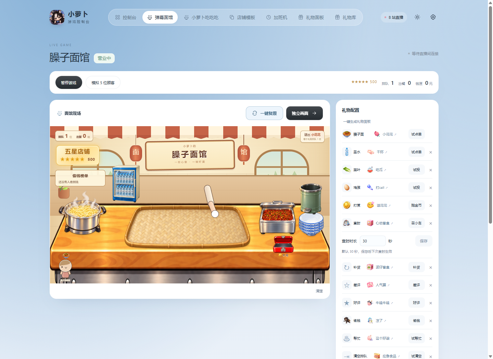
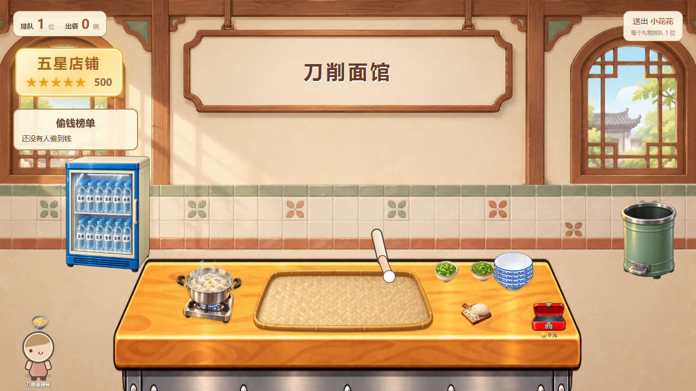
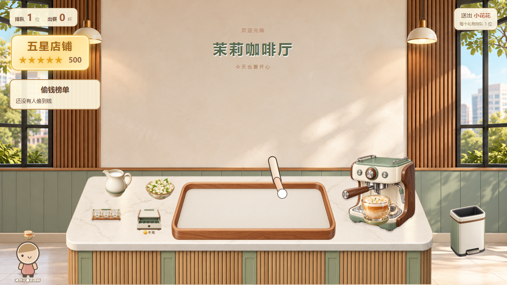
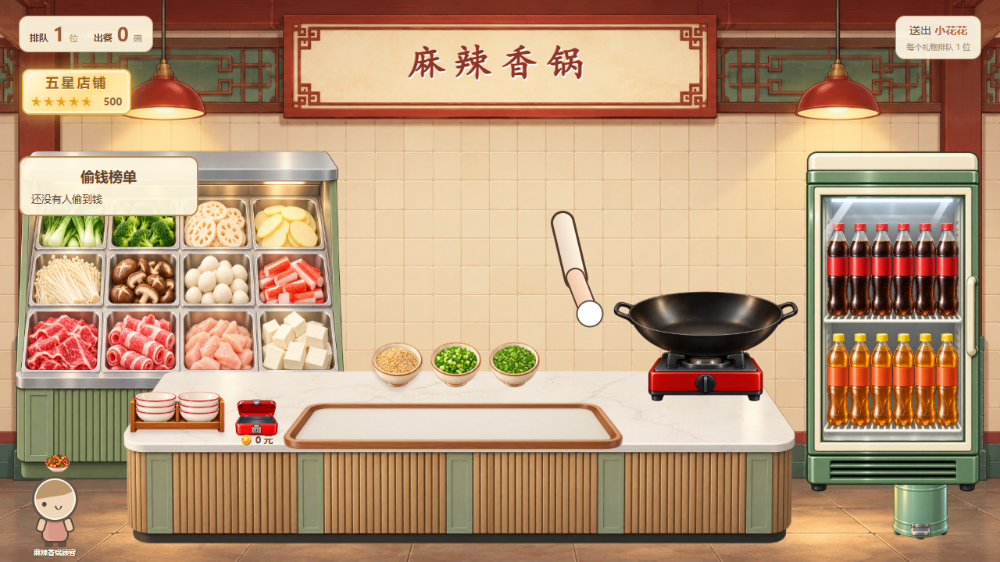
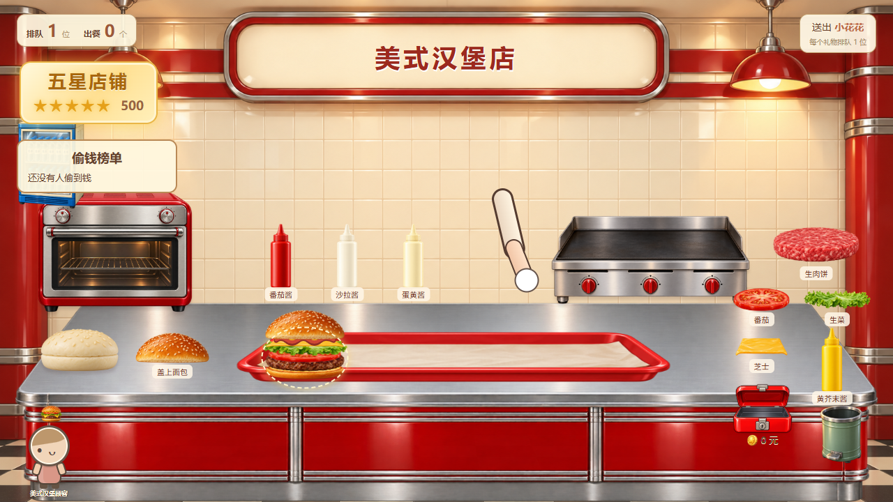
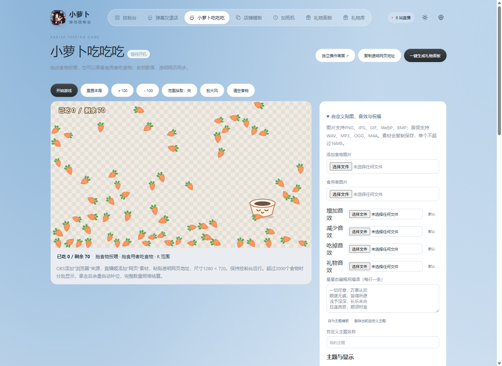
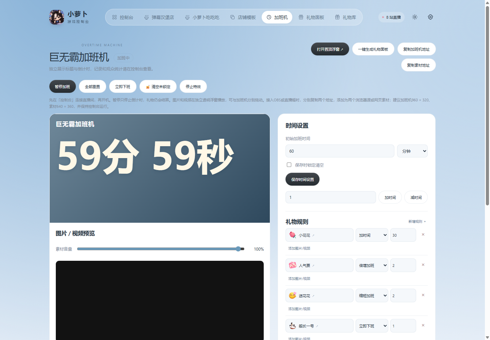
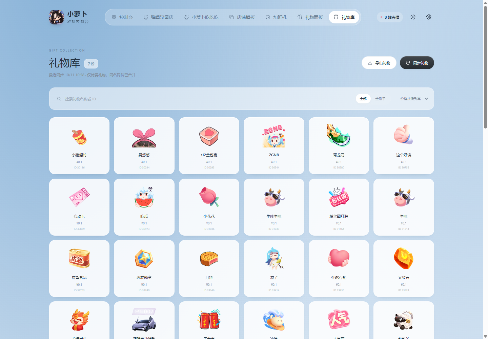

# 小萝卜游戏控制台 v3.2.1

连接 B站 / 抖音直播间，管理弹幕店铺、吃吃吃、抽奖与决斗、数字炸弹、加班机和礼物互动。

[下载最新版：安装包、便携版和店铺模板](https://github.com/luoboovo/xiaoluobo-console/releases/latest)

## 界面预览

以下为 v2.5.7 的实际界面截图，使用独立演示数据。

### 店铺控制台

同一页面操作游戏、配置点单与互动礼物，并打开独立直播画面。

### 独立店铺画面

四种外部模板可按需导入，独立画面可用于直播输出。

| 刀削面馆 | 茉莉咖啡厅 |
| --- | --- |
|  |  |

| 麻辣香锅 | 美式汉堡店 |
| --- | --- |
|  |  |

### 小萝卜吃吃吃

拖动食物投喂，自定义贴图、音效和礼物规则，透明网页画面实时同步。

### 加班机与礼物库

| 加班机：倒计时与礼物规则 | 礼物库：搜索、筛选与导出 |
| --- | --- |
|  |  |

## 版本更新

v3.2.1：礼物感谢按金额分档更可靠，礼物价值算得更准。

- 每档「AI 要求」：每个礼物档位可以写一句给 AI 的要求（比如 0～1 元这一档「阴阳怪气地谢，嫌礼物小」）。礼物落在哪一档由程序判断，AI 照这一档的要求写，不再固定叫它「越贵越热情」；「AI 写几句」也按这条要求写。给 AI 的价值同时写元和电池（1 元 = 10 电池）。
- 礼物库里没有的礼物（新出的、限定的）：发感谢前自动按当前直播间刷新一次礼物库查单价（10 分钟最多一次），新礼物存进礼物库；手动「刷新礼物库」后机器人也直接用新价格。实在查不到就算「价值不清楚」，不归进任何档，也不让 AI 猜金额，以前会被当成 0 元归进最低一档。
- 银瓜子礼物（辣条等免费礼物）按 0 元算，以前会把银瓜子当成金瓜子算进价值；礼物消息缺单价时用总价除以数量。

v3.2.0：礼物感谢按金额分档、可全部交给 AI 按人设现写，新增点赞、好久不见欢迎、盲盒盈亏和增量更新包。

- 礼物分档：「感谢礼物」按连击合并后的总金额分档，每档设「从多少元到多少元」（含起点、不含上限，最高一档可不封顶，最多 8 档），每档写几句话术随机用，也可以勾「AI 现写」或点「AI 写几句」。不在任何档里的礼物用默认一句；旧版的谢礼物话术自动搬进最低一档。
- 每个礼物都用 AI 谢：打开后礼物、盲盒、大航海和醒目留言都由 AI 严格按「AI 聊天」里的人设现写，送礼密时排队等 AI；只有 AI 出错才用写好的话术，并在日志里标出原因。
- 盲盒盈亏：盲盒感谢默认带上这次赚了还是亏了多少，还能用 {today_profit} 今天累计、{total_profit} 一直累计、{cost} 花费、{value} 开出价值。没改过的旧默认话术自动换成新的。
- 好久不见：控制台记住每位观众最后一次来的时间（重启后也记得），隔了设定的天数（默认 1 天）再来，单独说一句「好久不见」，{ago} 显示多久没来。
- 给直播间点赞：用控制台登录的 B站账号给正在连接的直播间点赞，一次最多 1000 个。
- 直播场景：可以勾「AI 现编」让模型现写应援；房管、主播或指定观众 @机器人 说「开启唱歌模式」「关闭打call」就能切换场景。
- 「一条弹幕最多几个字」交给你设（10～100），AI 写的话都不超过它，一条发完不再拆成几条；万一写长了在标点处截断。
- 增量更新包：新增 `npm run package:update`，只打包和旧版本相比改动的文件（约 2.5 MB），装好的旧版本可以直接升级。
- 修复送礼高峰时新消息插到正在发的那条前面、导致发错条目的问题。

v3.1.0：直播机器人可以换 AI 服务商，并新增直播场景。

- AI 服务商：「AI 聊天」里可选智谱 BigModel、硅基流动、OpenRouter、本机 Ollama、DeepSeek 官方和自定义（兼容 OpenAI 接口的地址），有免费模型的排在前面。每家的 Key 分开加密保存，原来的 DeepSeek Key 自动保留；「去获取 Key ↗」用系统浏览器打开对应的 Key 页面。切换后自动读出这家可用的模型，免费的标「（免费）」排在最前；本机 Ollama 不用 Key。人设回复、按语气挑表情和点名搭话都跟着当前服务商走。
- 直播场景：「表情包」下面新增「直播场景」，自带唱歌、跳舞、打游戏三个，最多 8 个，可增删改名。每个场景设应援话术（每行一句，随机发、不连着重复）和发送间隔，并能配一组场景表情（比如唱歌配「打call」）。点「开始」后按间隔发「一句应援 + 一个场景表情」，直到点「停止」；同一时间只进行一个场景，停止机器人或删掉该场景时自动停，待发消息较多时跳过这一轮。

v3.0.0：新增「直播机器人」页，放在控制台后面，用控制台登录的 B站账号在直播间发言。

- 欢迎与感谢：欢迎进场观众（几秒内多人合并成一句，同一人 30 分钟只欢迎一次）；感谢礼物（连击合并）、盲盒、大航海、醒目留言和关注，话术都可以改。
- 盲盒记录：连接直播间期间自动记下每位观众开的盲盒；观众 @机器人 发「查询盲盒记录」，会回复他今天和累计的个数、投入、开出和盈亏。还可以用主播账号读取后台礼物流水，补录近 180 天的历史盲盒，与实时记录合并、不重复计数。
- AI 聊天：观众 @机器人 时接入 DeepSeek，按自定义人设回复提问的人，太长会分成几条弹幕；模型下拉列出账号可用的全部模型。
- 表情包：读取本直播间可用的表情（含主播专属表情）。欢迎、谢礼物、谢大礼物、谢大航海、谢关注、盲盒查询的赚了/亏了/没记录、AI 回复、点名各有一组表情，机器人每次说完话从对应那组里挑一个接着发；AI 回复由 DeepSeek 按语气挑。
- 点名冒泡：进场满一段时间还没说话的观众，会被隔一阵 @ 一位；「随机点名一次」从房间里任意抽一位 @ 一下。话术可写多句随机用，也可以让 AI 按人设搭话。
- 修复读不到弹幕里 @ 对象的问题：B站回复弹幕和抖音评论里被 @ 的人，现在会显示在实时消息里。发弹幕时补上网页端的签名。
- 抖音暂不支持机器人发言，回复只显示在控制台。

v2.8.6：直播中出现意外错误时不再卡住整个控制台。以前后台一出错就会弹出必须点掉的报错框，点掉之前店铺画面、加班机、弹幕和礼物接收全部停住；现在错误会写进诊断日志，并在控制台事件里提示一条（每 10 秒最多一条），程序照常运行。保存浮窗位置失败等运行中的提示也改为不阻塞的提示框；启动失败和退出时保存失败仍会弹出提示后再关闭。

v2.8.5：吃吃吃两处改进。礼物规则的下拉框里可以直接选「范围拾取」，不用再单独点「添加范围规则」，选中后数值即拾取秒数（1–3600 的整数）；拖动食用者时，画面上被它盖住的已落地食物也会被吃掉，以前要几乎压到食用者正中才算碰到，下落食物的判定不变。

v2.8.4：减轻 OBS 面馆画面的数据负担。背景、桌台、顾客三层画面在送礼高峰时每秒各收到多次店铺状态，以前每次都带着模板、配置、模板列表和店铺列表；现在这几项只在变化时发送，其余时候沿用画面上已有的一份，每次收到的数据从约 8–9 KB 降到 1 KB 左右。汉堡、香锅、咖啡、刀削面和臊子面都适用；画面断线重连、切换店铺或修改配置时仍会收到完整数据。

v2.8.3：继续减少 OBS 崩溃。加班机礼物面板在送礼高峰时不再每 0.1 秒重建全部礼物图片，内容不变就保持原样，规则和样式修改仍立即生效；吃吃吃的自定义音效改为每个文件复用一个播放器（最多保留 8 个），批量送礼时不再在 OBS 里堆积大量音频流，同一音效连续触发时从头重新播放。

v2.8.2：降低 OBS 内存占用，减少 OBS 崩溃。导入 OBS 的面馆背景、桌台、顾客三层浏览器源改为「不可见时关闭源」，切到其他场景时不再在后台渲染三张 1080p 网页；切回面馆场景时画面重新加载，队伍和进度从后台恢复。之前导入过的场景，再点一次「导入 OBS」即可补上这项设置，其余设置保持不变。

v2.8.1：修复系统盘占用越来越大。加班机导入的图片/视频和吃吃吃上传的素材以前只存不删，现在启动时和修改设置后，会自动删除已经不在任何规则里的素材（刚导入一小时内、还没保存的素材会保留）；加班机视频不再额外存进浏览器缓存。

v2.8.0：大幅降低批量送礼时的内存和卡顿。带头像的礼物、弹幕和进场消息合并按到达顺序批量处理，不再每份礼物单独结算、单独保存加班机记录；同样 3000 份礼物，处理时间从约 43 秒降到 1 秒内，写盘量从约 4 GB 降到 25 MB。加班机浮窗和 OBS 画面不再接收观众统计列表，控制台的观众统计在送礼高峰时每秒最多刷新一次，最终结果保持一致；画面进程在送礼高峰时的内存增量约减少六成。弹幕面馆、吃吃吃在大量礼物下减少不必要的复制，加班机素材浮窗播放结束一分钟后自动释放，下次有素材时重新打开。排队、金额、加班时间和去重规则不变。

v2.7.7：进一步降低基础运行内存。只加载当前功能的预览，切出页面时释放预览，返回时恢复；背景层、顾客层不再加载整套厨房图片。小贴图和缩略图使用按用途生成的显示副本，原模板、原图和导出保留；显示副本缓存到磁盘，后台串行处理，空闲后退出处理线程。未打开的功能图片延迟加载，吃吃吃配置中的 PNG 也使用小缩略图。首次显示素材会生成缓存，之后直接复用。

v2.7.6：优化连续制作汉堡、臊子面、刀削面、香锅和咖啡时的图片内存。餐品各阶段、点单图、汉堡食材和制作批次改为复用图片与少量界面元素，避免不断销毁、换源和重新解码；咖啡机保留制作阶段图片，香锅食材篮只在内容变化时更新。切换模板或关闭预览时清理缓存，出餐及金额规则保持原样。

v2.7.5：针对多人同时送礼并操作店铺时的内存压力，固定贴图只在模板或查封状态改变时重新应用，避免一次请求与礼物更新交叠就反复切换和加载大图。离场动画最多保留当前队伍的显示容量，防止批量帮忙出餐时堆积大量顾客节点；出餐、金币和观众统计完整保留。

v2.7.4：修复店铺画面渲染进程崩溃后持续白屏，自动重新加载并恢复后台中的当前队伍和进度，一分钟最多自动重载两次，避免反复崩溃时陷入循环。诊断日志增加画面进程、GPU 和系统可用内存，帮助定位批量送礼时的内存不足；同时修复昵称、弹幕或标题带 Unicode 分隔符时推送解析中断。

v2.7.3：新增数字炸弹与排队模式，支持弹幕报名、可设置的每人猜数 CD、拖动玩家顺序、数字格头像与爆炸揭晓。顶部导航保持单行，多余入口收进三个点菜单，点击后竖向展开。

v2.7.2：搭建场景时可拖动任意排队小人，整体移动队伍，榜单和文字保持原位。支持独立缩放、取消和保存，移动后递餐位置及直播画面同步跟随。

数字炸弹：观众默认发送「参与数字炸弹」报名，主播点击开始后锁定名单，随机生成范围内的炸弹数字。已报名观众可多次发送纯数字猜数，按弹幕到达顺序判定，每个账号默认间隔 3 秒，可在开局前设置为 0～60 秒。有效猜数收紧范围（包含两端），安全通过时头像显示在该数字上方，踩中后在中央放大展示头像和昵称。两侧观众席显示头像与弹幕气泡，最多 100 人，可滚动查看。支持暂停、继续和重新报名，以及 1280 × 720 独立直播网页画面。B站和抖音分别保存设置、名单和本轮进度；重启或切换平台后，进行中的回合暂停，点击继续即可恢复。

数字炸弹可切换「自由模式 / 排队模式」。排队模式下，在已报名名单中拖动玩家或使用上下按钮调整顺序，保存后仅轮到的玩家可以猜数；每次有效猜数后依次轮转。越界、CD 中和未轮到的数字不计入，也不推进队伍。游戏中调序会保留当前玩家，下一手按新顺序继续。顺序和当前玩家随本轮保存，直播画面同步编号与高亮；没有超时自动跳过。

v2.7.0「抽奖工具」只包含大转盘、决斗、刮刮乐三个玩法，数据源完全分开。每个玩法各自保存名单、报名口令、匹配方式、中奖移出设置、报名开关、本轮进度和最近50轮结果；手动录入草稿、未保存的设置、清空和导出也只作用于当前玩法。可以在转盘运行时切去操作决斗或刮刮乐。决斗继续显示观众头像。B站与抖音各自拥有独立的三套数据。

刮刮乐参考 [GACHAGO 一番赏](https://www.gachago.net/zh-cn/Ichiban) 的撕签玩法：彩色立体签卡散落堆叠，点击签卡或「抽奖」随机选取，「摇动」将卡堆抛起重新摆放。选中后可从左向右拖动签面撕开，或点击「撕开」自动揭晓；没撕开前可以放回。撕开时保留左侧彩框与白色签面，右侧翻出蓝白边、黑底奖级字母和锯齿边的奖签，奖名在下方揭晓。支持「奶茶 * 5」数量输入和「#A 大奖 * 1」奖级，一份对应一张实体签，最多200张。抽中后按设置移出这一张，结果只结算一次。画面内「设定」可以直接修改自己的奖池，也可在控制台录入或开启弹幕报名。默认口令分别为「参加」「决斗」「刮刮乐」，可独立修改；多个玩法同时使用相同口令时，会分别加入各自名单。
