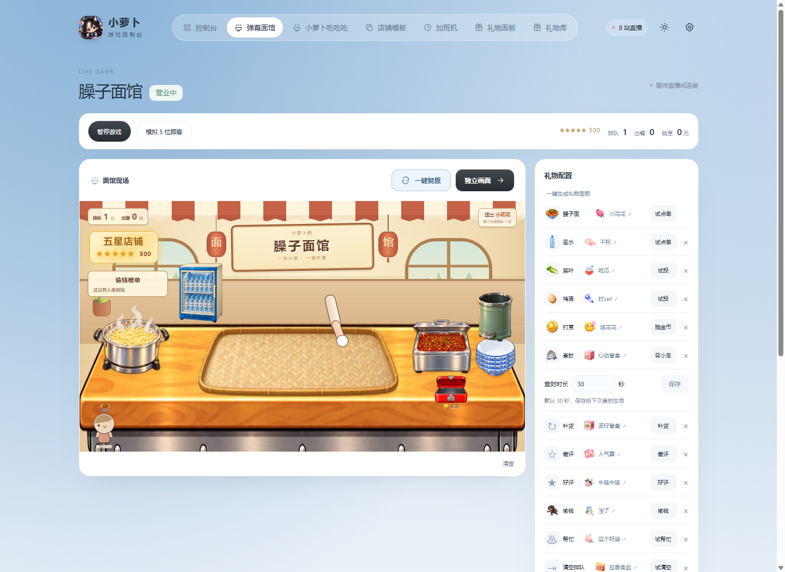
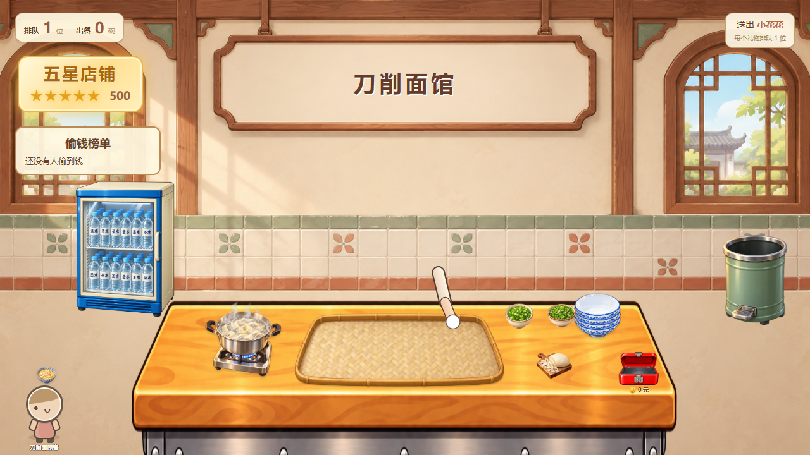
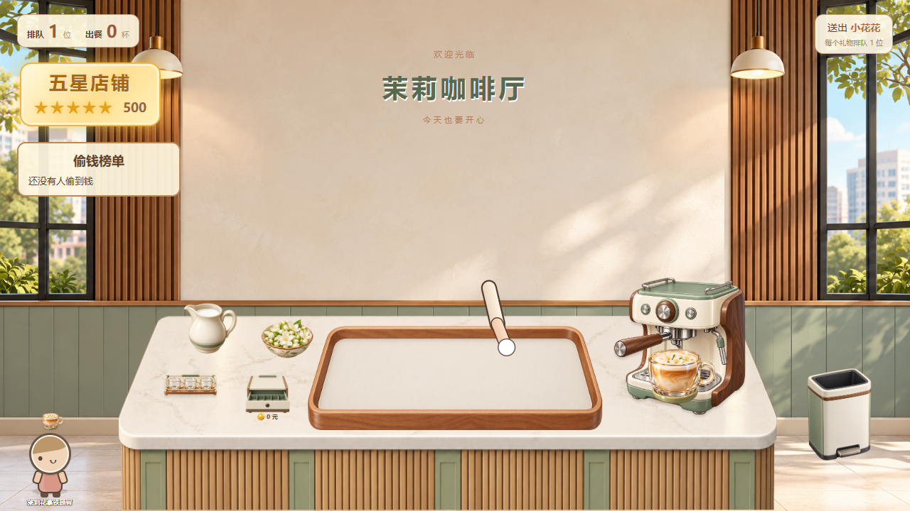
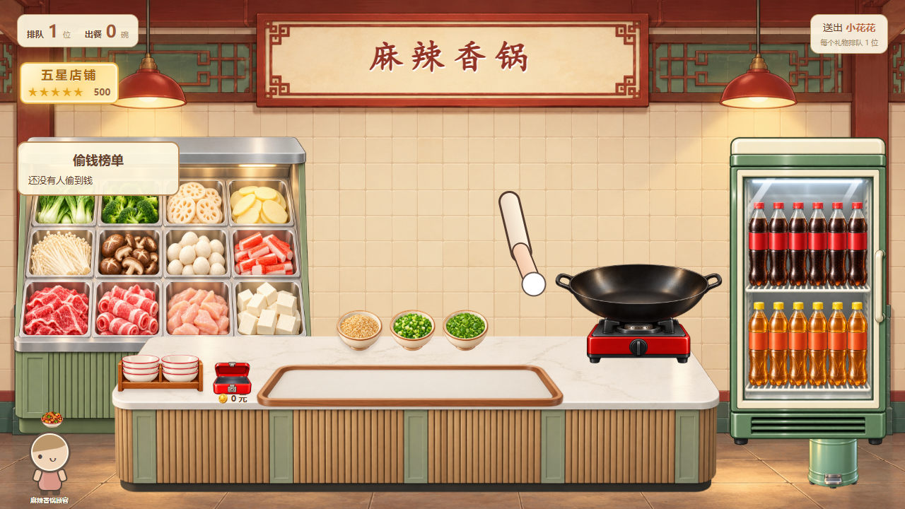
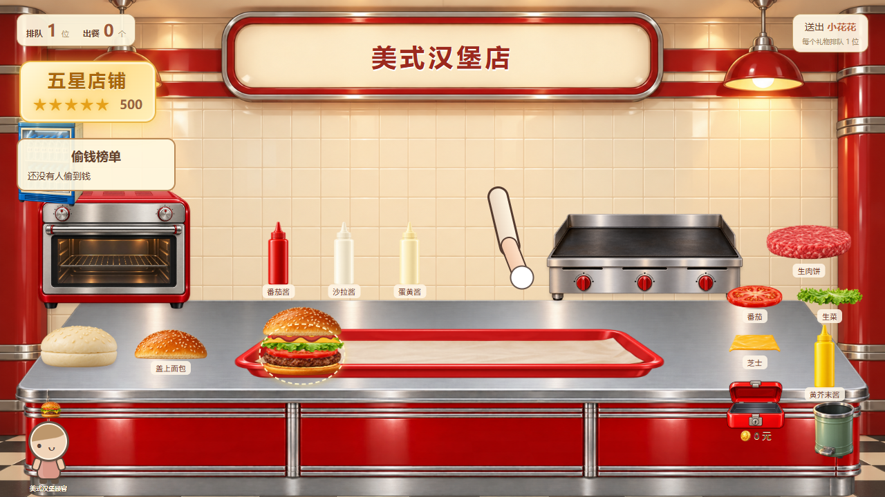
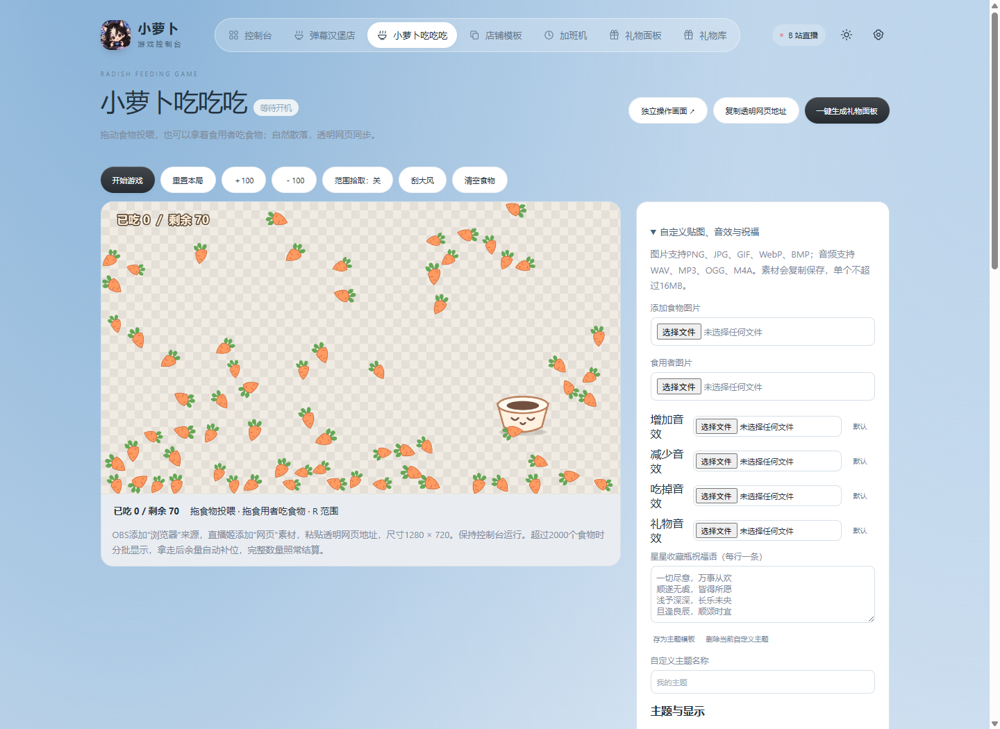
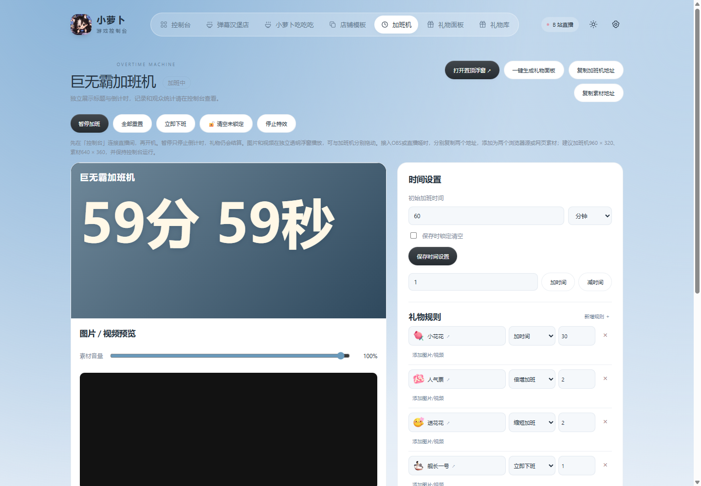
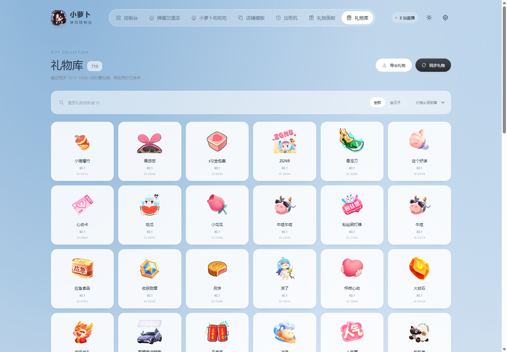

# 小萝卜游戏控制台 v2.8.4

连接 B站 / 抖音直播间，管理弹幕店铺、吃吃吃、抽奖与决斗、数字炸弹、加班机和礼物互动。

[下载最新版：安装包、便携版和店铺模板](https://github.com/luoboovo/xiaoluobo-console/releases/latest)

## 界面预览

以下为 v2.5.7 的实际界面截图，使用独立演示数据。

### 店铺控制台

同一页面操作游戏、配置点单与互动礼物，并打开独立直播画面。

### 独立店铺画面

四种外部模板可按需导入，独立画面可用于直播输出。

| 刀削面馆 | 茉莉咖啡厅 |
| --- | --- |
|  |  |

| 麻辣香锅 | 美式汉堡店 |
| --- | --- |
|  |  |

### 小萝卜吃吃吃

拖动食物投喂，自定义贴图、音效和礼物规则，透明网页画面实时同步。

### 加班机与礼物库

| 加班机：倒计时与礼物规则 | 礼物库：搜索、筛选与导出 |
| --- | --- |
|  |  |

## 版本更新

v2.8.4：减轻 OBS 面馆画面的数据负担。背景、桌台、顾客三层画面在送礼高峰时每秒各收到多次店铺状态，以前每次都带着模板、配置、模板列表和店铺列表；现在这几项只在变化时发送，其余时候沿用画面上已有的一份，每次收到的数据从约 8–9 KB 降到 1 KB 左右。汉堡、香锅、咖啡、刀削面和臊子面都适用；画面断线重连、切换店铺或修改配置时仍会收到完整数据。

v2.8.3：继续减少 OBS 崩溃。加班机礼物面板在送礼高峰时不再每 0.1 秒重建全部礼物图片，内容不变就保持原样，规则和样式修改仍立即生效；吃吃吃的自定义音效改为每个文件复用一个播放器（最多保留 8 个），批量送礼时不再在 OBS 里堆积大量音频流，同一音效连续触发时从头重新播放。

v2.8.2：降低 OBS 内存占用，减少 OBS 崩溃。导入 OBS 的面馆背景、桌台、顾客三层浏览器源改为「不可见时关闭源」，切到其他场景时不再在后台渲染三张 1080p 网页；切回面馆场景时画面重新加载，队伍和进度从后台恢复。之前导入过的场景，再点一次「导入 OBS」即可补上这项设置，其余设置保持不变。

v2.8.1：修复系统盘占用越来越大。加班机导入的图片/视频和吃吃吃上传的素材以前只存不删，现在启动时和修改设置后，会自动删除已经不在任何规则里的素材（刚导入一小时内、还没保存的素材会保留）；加班机视频不再额外存进浏览器缓存。

v2.8.0：大幅降低批量送礼时的内存和卡顿。带头像的礼物、弹幕和进场消息合并按到达顺序批量处理，不再每份礼物单独结算、单独保存加班机记录；同样 3000 份礼物，处理时间从约 43 秒降到 1 秒内，写盘量从约 4 GB 降到 25 MB。加班机浮窗和 OBS 画面不再接收观众统计列表，控制台的观众统计在送礼高峰时每秒最多刷新一次，最终结果保持一致；画面进程在送礼高峰时的内存增量约减少六成。弹幕面馆、吃吃吃在大量礼物下减少不必要的复制，加班机素材浮窗播放结束一分钟后自动释放，下次有素材时重新打开。排队、金额、加班时间和去重规则不变。

v2.7.7：进一步降低基础运行内存。只加载当前功能的预览，切出页面时释放预览，返回时恢复；背景层、顾客层不再加载整套厨房图片。小贴图和缩略图使用按用途生成的显示副本，原模板、原图和导出保留；显示副本缓存到磁盘，后台串行处理，空闲后退出处理线程。未打开的功能图片延迟加载，吃吃吃配置中的 PNG 也使用小缩略图。首次显示素材会生成缓存，之后直接复用。

v2.7.6：优化连续制作汉堡、臊子面、刀削面、香锅和咖啡时的图片内存。餐品各阶段、点单图、汉堡食材和制作批次改为复用图片与少量界面元素，避免不断销毁、换源和重新解码；咖啡机保留制作阶段图片，香锅食材篮只在内容变化时更新。切换模板或关闭预览时清理缓存，出餐及金额规则保持原样。

v2.7.5：针对多人同时送礼并操作店铺时的内存压力，固定贴图只在模板或查封状态改变时重新应用，避免一次请求与礼物更新交叠就反复切换和加载大图。离场动画最多保留当前队伍的显示容量，防止批量帮忙出餐时堆积大量顾客节点；出餐、金币和观众统计完整保留。

v2.7.4：修复店铺画面渲染进程崩溃后持续白屏，自动重新加载并恢复后台中的当前队伍和进度，一分钟最多自动重载两次，避免反复崩溃时陷入循环。诊断日志增加画面进程、GPU 和系统可用内存，帮助定位批量送礼时的内存不足；同时修复昵称、弹幕或标题带 Unicode 分隔符时推送解析中断。

v2.7.3：新增数字炸弹与排队模式，支持弹幕报名、可设置的每人猜数 CD、拖动玩家顺序、数字格头像与爆炸揭晓。顶部导航保持单行，多余入口收进三个点菜单，点击后竖向展开。

v2.7.2：搭建场景时可拖动任意排队小人，整体移动队伍，榜单和文字保持原位。支持独立缩放、取消和保存，移动后递餐位置及直播画面同步跟随。

数字炸弹：观众默认发送「参与数字炸弹」报名，主播点击开始后锁定名单，随机生成范围内的炸弹数字。已报名观众可多次发送纯数字猜数，按弹幕到达顺序判定，每个账号默认间隔 3 秒，可在开局前设置为 0～60 秒。有效猜数收紧范围（包含两端），安全通过时头像显示在该数字上方，踩中后在中央放大展示头像和昵称。两侧观众席显示头像与弹幕气泡，最多 100 人，可滚动查看。支持暂停、继续和重新报名，以及 1280 × 720 独立直播网页画面。B站和抖音分别保存设置、名单和本轮进度；重启或切换平台后，进行中的回合暂停，点击继续即可恢复。

数字炸弹可切换「自由模式 / 排队模式」。排队模式下，在已报名名单中拖动玩家或使用上下按钮调整顺序，保存后仅轮到的玩家可以猜数；每次有效猜数后依次轮转。越界、CD 中和未轮到的数字不计入，也不推进队伍。游戏中调序会保留当前玩家，下一手按新顺序继续。顺序和当前玩家随本轮保存，直播画面同步编号与高亮；没有超时自动跳过。

v2.7.0「抽奖工具」只包含大转盘、决斗、刮刮乐三个玩法，数据源完全分开。每个玩法各自保存名单、报名口令、匹配方式、中奖移出设置、报名开关、本轮进度和最近50轮结果；手动录入草稿、未保存的设置、清空和导出也只作用于当前玩法。可以在转盘运行时切去操作决斗或刮刮乐。决斗继续显示观众头像。B站与抖音各自拥有独立的三套数据。

刮刮乐参考 [GACHAGO 一番赏](https://www.gachago.net/zh-cn/Ichiban) 的撕签玩法：彩色立体签卡散落堆叠，点击签卡或「抽奖」随机选取，「摇动」将卡堆抛起重新摆放。选中后可从左向右拖动签面撕开，或点击「撕开」自动揭晓；没撕开前可以放回。撕开时保留左侧彩框与白色签面，右侧翻出蓝白边、黑底奖级字母和锯齿边的奖签，奖名在下方揭晓。支持「奶茶 * 5」数量输入和「#A 大奖 * 1」奖级，一份对应一张实体签，最多200张。抽中后按设置移出这一张，结果只结算一次。画面内「设定」可以直接修改自己的奖池，也可在控制台录入或开启弹幕报名。默认口令分别为「参加」「决斗」「刮刮乐」，可独立修改；多个玩法同时使用相同口令时，会分别加入各自名单。
